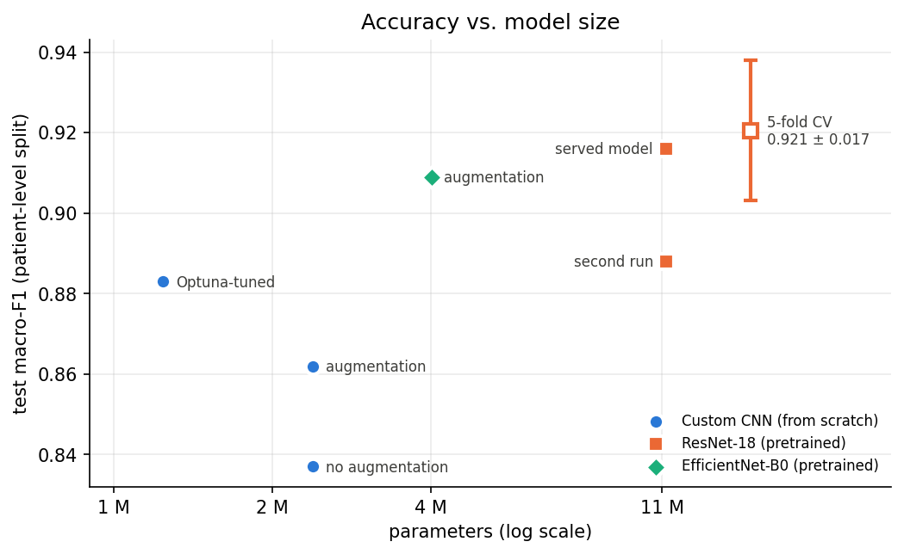
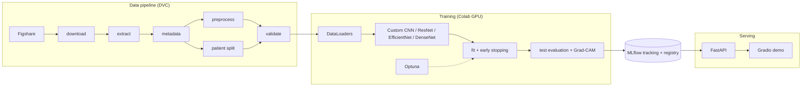

<div align="center">

# Brain Tumour MRI Classification

**A comparative study of convolutional neural networks, built on a reproducible MLOps pipeline**

[](https://github.com/Yassminefeki/brain-tumor-mlops/actions/workflows/ci.yml)


*Faculté des Sciences de Sfax — Département d'Informatique et des Communications*
*Apprentissage profond · I2 · 2026–2027*

</div>

---

## Overview

This project classifies T1-weighted contrast-enhanced brain MRI slices into three tumour
types — **meningioma**, **glioma** and **pituitary tumour** — and compares several CNN
architectures under identical, leakage-free conditions:

| Model | Type | Parameters |
|---|---|---|
| **Custom CNN** | Designed and trained from scratch | 2.39 M |
| **ResNet-18 / ResNet-50** | ImageNet-pretrained, two-stage fine-tuning | 11.2 M / 23.5 M |
| **EfficientNet-B0** | ImageNet-pretrained, two-stage fine-tuning | 4.0 M |
| **DenseNet-121** | ImageNet-pretrained, two-stage fine-tuning | 7.0 M |

Beyond the models, the repository is an end-to-end **MLOps** project: versioned data
(DVC), tracked experiments (MLflow), automated hyperparameter search (Optuna), tests and
CI (pytest, GitHub Actions), explainability (Grad-CAM) and serving (FastAPI, Gradio, Docker).

> **Medical disclaimer.** This is an educational project. The models are not medical
> devices and must not be used for diagnosis.

## Key points

- **Patient-level split.** The dataset has 3,064 slices from only 233 patients. Images are
  split *by patient* so no patient appears in both training and test sets; an image-level
  split is kept only to measure how much leakage inflates scores.
- **Fair comparison.** Same data, same preprocessing, same selection rule (best validation
  macro-F1), same tuning budget; the test set is used once per final run.
- **Full traceability.** Every MLflow run records its parameters, Git commit and DVC data
  version, so any number in the report can be traced back and reproduced.

## Results

Colab T4 GPU, run of 2026-11-27. Full training logs:
[`notebooks/runs/02_colab_runner_2026-11-27.ipynb`](notebooks/runs/02_colab_runner_2026-11-27.ipynb).
Unless stated otherwise: fixed test set of 420 images, patient-level split, scores with
test-time augmentation (horizontal flip), checkpoint chosen on validation macro-F1.

| Model | Val macro-F1 | Test accuracy | Test macro-F1 | Params | ms / image |
|---|---|---|---|---|---|
| Majority class (baseline) | — | 0.448 | 0.206 | — | — |
| Custom CNN, no augmentation | 0.920 | 0.850 | 0.837 | 2.39 M | 1.7 |
| Custom CNN | 0.933 | 0.871 | 0.862 | 2.39 M | 1.9 |
| Custom CNN, Optuna-tuned | 0.822 | 0.886 | 0.883 | 1.24 M | 1.5 |
| **ResNet-18** (served) | 0.957 | **0.921** | **0.916** | 11.2 M | 2.5 |
| EfficientNet-B0 | 0.946 | 0.917 | 0.909 | 4.0 M | 8.7 |
| ResNet-18, 5-fold CV (mean ± std) | 0.932 ± 0.041 | 0.926 ± 0.016 | 0.921 ± 0.017 | 11.2 M | — |
| ResNet-18, second run (registered in MLflow) | 0.950 | 0.895 | 0.888 | 11.2 M | 2.7 |



Full table with training time: [`reports/comparison.md`](reports/comparison.md), built by
[`notebooks/03_results_analysis.ipynb`](notebooks/03_results_analysis.ipynb).

**Per-class recall** (test set, from MLflow):

| Model | Meningioma | Glioma | Pituitary |
|---|---|---|---|
| Majority class (baseline) | 0.000 | 1.000 | 0.000 |
| Custom CNN, no augmentation | 0.741 | 0.947 | 0.800 |
| Custom CNN | 0.777 | 0.936 | 0.858 |
| Custom CNN, Optuna-tuned | 0.991 | 0.862 | 0.825 |
| **ResNet-18** (served) | 0.929 | 0.947 | 0.875 |
| EfficientNet-B0 | 0.920 | 0.936 | 0.883 |
| ResNet-18, 5-fold CV (mean ± std) | 0.925 ± 0.023 | 0.950 ± 0.008 | 0.890 ± 0.048 |
| ResNet-18, second run (registered in MLflow) | 0.946 | 0.952 | 0.758 |

**Leakage.** The same ResNet-18 trained and tested on an *image-level* split reaches
0.967 accuracy / 0.963 macro-F1 (on a different, leaky test set of 460 images): +0.047 macro-F1
over the honest patient-level split, because 99.6% of those test images come from patients
seen in training. Image-level scores on this dataset overestimate real performance.

**Reading the table.**
- Pretrained models beat the custom CNN by 2.6–5.4 points of macro-F1; ResNet-18 is the
  best compromise of accuracy and speed (EfficientNet-B0 is 3.5x slower per image here).
- Augmentation (+0.025) and Optuna tuning (+0.021, with half the parameters) both help the
  custom CNN.
- Run-to-run variance is large on 420 test images: the two ResNet-18 runs share the same
  settings yet score 0.916 and 0.888, and the 5 folds span 0.891–0.937. The 5-fold
  mean ± std is the most reliable estimate.
- **Served model:** the first ResNet-18 run (`resnet18-aug-20261127-202800`), chosen by the
  project's selection rule, the best *validation* macro-F1 (0.957 against 0.950 for the second
  run). The second run is the one registered in the MLflow Model Registry (version 1).
- Inference time: batch size 1 on a T4 GPU.
- Per-class recall: the custom CNN mostly misses meningiomas (0.74–0.78) until tuning, which
  trades glioma recall for meningioma recall. With pretrained models the weakest class becomes
  pituitary tumour (0.76–0.93 depending on the run; 0.875 for the served model).
- Optuna: 3 of the 20 trials ran to the end; the median pruner stopped the other 17 early.
  MLflow shows those as `FAILED` with the tag `pruned=true`.
- Everything is in MLflow: open `mlflow.db` with `mlflow ui --backend-store-uri sqlite:///mlflow.db`
  or run [`notebooks/03_results_analysis.ipynb`](notebooks/03_results_analysis.ipynb).

## Architecture



Details: [docs/architecture.md](docs/architecture.md).

## Quick start

### 1. Install

First time (creates `.venv`, installs everything, initialises Git + DVC, runs the tests
and makes the first commit):

```bash
bash scripts/bootstrap.sh
```

Teammate cloning the existing repository:

```bash
git clone https://github.com/Yassminefeki/brain-tumor-mlops.git
cd brain-tumor-mlops
python3 -m venv .venv && source .venv/bin/activate
make install-dev          # package + dev tools + git hooks
cp .env.example .env      # then fill in your DagsHub credentials
```

### 2. Get the data

Either rebuild it from Figshare (≈ 1 GB download):

```bash
dvc repro                 # download -> extract -> metadata -> preprocess -> split -> validate
```

or download the exact version used by the team from the DVC remote:

```bash
dvc pull
```

### 3. Train

```bash
make baseline                          # majority-class reference
make train MODEL=custom_cnn
make train MODEL=resnet18
python -m brain_tumor.train train.model=efficientnet_b0 train.batch_size=64
```

Training needs a GPU: on a laptop CPU one epoch of the custom CNN takes 5–30 minutes. Use
Google Colab: open [`notebooks/02_colab_runner.ipynb`](notebooks/02_colab_runner.ipynb), select a
GPU runtime and add a `GITHUB_TOKEN` secret (the repository is private). It clones the repo, gets
the data (`dvc pull` from DagsHub, or `dvc repro` from Figshare without DagsHub), runs the same
commands and copies checkpoints, reports and `mlflow.db` to Google Drive. Copy the final
`models/best.pt` back into `models/` to serve it locally.

### 4. Inspect results

Open the MLflow UI on DagsHub (`https://dagshub.com/<user>/brain-tumor-mlops.mlflow`), or locally:

```bash
mlflow ui --backend-store-uri sqlite:///mlflow.db
```

### 5. Serve the best model

```bash
python -m brain_tumor.train train.model=resnet18 --promote   # -> models/best.pt
make api                                                      # http://localhost:8000/docs
make demo                                                     # http://localhost:7860
```

## Commands

| Command | Purpose |
|---|---|
| `make data` | Run the whole DVC data pipeline |
| `make test` | Unit + end-to-end tests on synthetic data |
| `make lint` / `make format` | Ruff checks / auto-format |
| `make baseline` | Majority-class baseline |
| `make train MODEL=<name>` | Train, evaluate on test, log to MLflow |
| `make tune MODEL=<name>` | Optuna search, writes `configs/best_params/<name>.yaml` |
| `make evaluate CKPT=<path>` | Re-evaluate a checkpoint |
| `make api` / `make demo` / `make docker` | Serving |

Any setting of [`params.yaml`](params.yaml) can be overridden from the command line:

```bash
python -m brain_tumor.train train.model=custom_cnn train.augment=false train.epochs=30
python -m brain_tumor.train train.model=resnet18 train.split_column=image_split   # leakage demo
python -m brain_tumor.train train.model=custom_cnn train.fold=0                  # CV fold 0
python -m brain_tumor.train train.model=custom_cnn --best-params configs/best_params/custom_cnn.yaml
```

## Project structure

```
brain-tumor-mlops/
├── .github/             CI workflow and pull-request template
├── api/                 FastAPI service (main.py) and Gradio demo (gradio_app.py)
├── configs/best_params/ Hyperparameters found by Optuna (versioned in Git)
├── data/                DVC-managed: raw/, interim/, processed/, metadata.csv, splits.csv
├── docs/                Detailed documentation (see below)
├── notebooks/           EDA, Colab runner, results analysis
├── reports/             Figures and metrics for the report
├── scripts/             bootstrap.sh (one-time local setup)
├── src/brain_tumor/
│   ├── data/            ingest, metadata, preprocess, split, validate, dataset, transforms
│   ├── models/          custom_cnn, pretrained, factory
│   ├── training/        engine (fit / evaluate), metrics
│   ├── explain/         Grad-CAM
│   ├── train.py         training entry point
│   ├── tune.py          Optuna search
│   ├── evaluate.py      test evaluation
│   ├── baseline.py      majority-class baseline
│   ├── inference.py     prediction on new images
│   └── tracking.py      MLflow helpers and lineage
├── tests/               pytest suite (synthetic data, no download needed)
├── params.yaml          every hyperparameter and path
├── dvc.yaml             data pipeline definition
└── Dockerfile           inference image
```

## Documentation

| Document | Content |
|---|---|
| [Project guide](docs/project_guide.md) | **Everything in one place**: data, models, training, results, MLOps, Q&A |
| [Architecture](docs/architecture.md) | Components, local vs. remote, how they communicate |
| [Data pipeline](docs/data_pipeline.md) | Each DVC stage, its inputs, outputs and checks |
| [Models](docs/models.md) | Custom CNN design and pretrained transfer-learning recipe |
| [Training](docs/training.md) | Training workflow, metrics, Optuna, reproducibility |
| [Experiments](docs/experiments.md) | Experiment plan and how to report results |
| [MLOps setup](docs/mlops_setup.md) | GitHub, DagsHub, DVC, MLflow, Colab — step by step |
| [Dataset card](docs/dataset_card.md) | Source, composition, limitations, citations |
| [Model card](docs/model_card.md) | Intended use, evaluation, limitations |
| [Contributing](CONTRIBUTING.md) | Branches, commits, review rules |

## MLOps stack

| Concern | Tool |
|---|---|
| Code versioning, review, CI | Git, GitHub, GitHub Actions |
| Data versioning and pipeline | DVC (remote storage on DagsHub) |
| Experiment tracking, model registry | MLflow (server hosted on DagsHub) |
| Hyperparameter optimisation | Optuna (TPE sampler, median pruning) |
| Configuration | `params.yaml` + command-line overrides |
| Quality | pytest, Ruff, pre-commit, data validation stage |
| Explainability | Grad-CAM |
| Serving | FastAPI, Gradio, Docker |
| Compute | Google Colab (GPU) |

## Citation

If you use this code, please cite the dataset papers (see [CITATION.cff](CITATION.cff)):

> Cheng, J. et al. *Enhanced Performance of Brain Tumor Classification via Tumor Region
> Augmentation and Partition.* PLoS ONE 10(10): e0140381, 2015.
>
> Cheng, J. et al. *Retrieval of Brain Tumors by Adaptive Spatial Pooling and Fisher Vector
> Representation.* PLoS ONE 11(6): e0157112, 2016.

## Authors

- **Yassmine Feki** — Faculté des Sciences de Sfax
- **Nour Al Houda Ben Slimene** — Faculté des Sciences de Sfax

## License

Code released under the [MIT License](LICENSE). The MRI dataset is not redistributed here;
it is downloaded from [Figshare](https://figshare.com/articles/dataset/brain_tumor_dataset/1512427)
and remains subject to the terms stated there.
