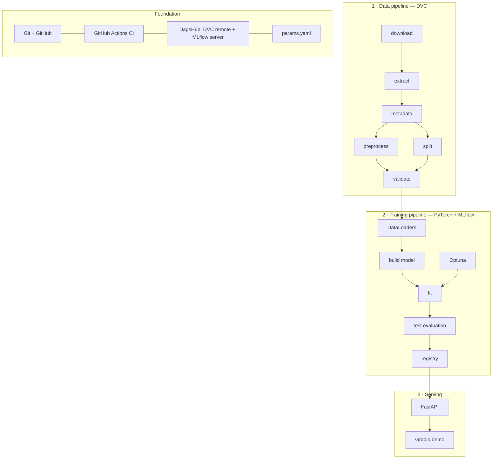
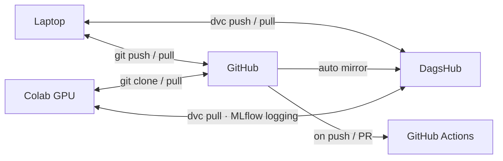
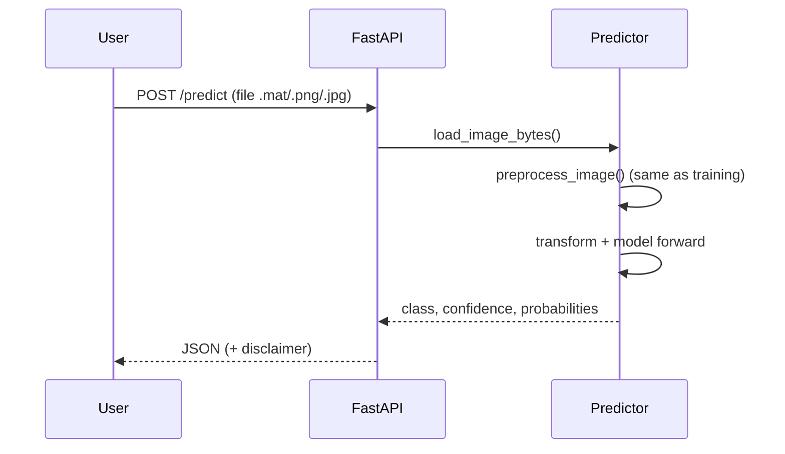

# Architecture

## 1. Global view

The project is made of three pipelines on a shared MLOps foundation.



| Layer | Responsibility | Main modules |
|---|---|---|
| Data pipeline | Turn the Figshare archives into validated, versioned, model-ready arrays | `brain_tumor.data.*`, `dvc.yaml` |
| Training | Train, select by validation macro-F1, evaluate once on test, log everything | `train.py`, `training/engine.py`, `evaluate.py`, `tune.py` |
| Serving | Expose the promoted model | `inference.py`, `api/` |
| Foundation | Versioning, configuration, automation | Git, DVC, MLflow, CI, `params.yaml` |

## 2. Where things live

| Item | Laptop | GitHub | DagsHub | Colab |
|---|---|---|---|---|
| Source code, `params.yaml`, `dvc.yaml`, `dvc.lock` | ✔ working copy | ✔ reference | ✔ mirror | cloned per session |
| Data (`data/`) | ✔ DVC cache | ✘ | ✔ DVC storage | `dvc pull` per session |
| Experiments, metrics, checkpoints | via browser | ✘ | ✔ MLflow server | logs to MLflow |
| Tuned hyperparameters (`configs/best_params/`) | ✔ | ✔ | ✔ mirror | pushed back with a token |
| Secrets | `.env`, `.dvc/config.local` (ignored) | Actions secrets | token issuer | Colab secrets |

Colab is **stateless**: nothing important is stored there. Code comes from GitHub, data
from DagsHub (DVC), and results go to DagsHub (MLflow).

## 3. How the pieces communicate



Rule of thumb: **`dvc push` before `git push`**. Otherwise a teammate receives a `dvc.lock`
pointing to data that is not uploaded yet.

## 4. Lineage of a result

Every training run stores three identifiers as MLflow tags/params:

| What | Recorded as | Source |
|---|---|---|
| Code | `git.commit`, `git.branch`, `git.dirty` | `git rev-parse` |
| Data | `data.processed_md5`, `data.splits_md5` | `dvc.lock` |
| Configuration | every value of `params.yaml` used by the run | resolved config |

With these three, any number in the report can be reproduced:

```bash
git checkout <git.commit>
dvc checkout            # restores the matching data version
python -m brain_tumor.train <same overrides>
```

## 5. Package layout

```
src/brain_tumor/
├── config.py          load params.yaml, dotted overrides, path resolution
├── utils.py           seeding, device, logging, git info, JSON
├── tracking.py        MLflow connection, params flattening, lineage tags
├── data/
│   ├── mat_io.py      read the HDF5 .mat files (orientation fix, PID decoding)
│   ├── ingest.py      stages download + extract
│   ├── metadata.py    stage metadata
│   ├── preprocess.py  stage preprocess (also used at inference)
│   ├── split.py       stage split (patient-level, CV folds, leaky comparison split)
│   ├── validate.py    stage validate (quality gate)
│   ├── dataset.py     torch Dataset over .npy arrays (RAM preload)
│   ├── transforms.py  augmentation, 3-channel + ImageNet normalisation
│   └── datamodule.py  DataLoaders, CV fold selection, class weights
├── models/
│   ├── custom_cnn.py  model A
│   ├── pretrained.py  ResNet / EfficientNet / DenseNet + parameter groups
│   └── factory.py     build_model(cfg), Grad-CAM target layer
├── training/
│   ├── engine.py      training plan, optimiser, scheduler, fit, evaluate
│   └── metrics.py     metrics, confusion matrix, training curves
├── explain/gradcam.py Grad-CAM
├── train.py / tune.py / evaluate.py / baseline.py   command-line entry points
└── inference.py       Predictor used by the API and the demo
```

## 6. Serving



The checkpoint stores the model name, its configuration and the preprocessing parameters,
so the API applies exactly the training preprocessing without any extra configuration.
