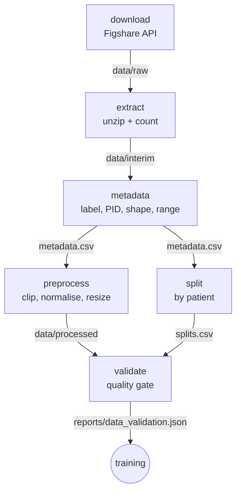

# Data pipeline

The pipeline is declared in [`dvc.yaml`](../dvc.yaml) and run with `dvc repro`. Each stage
reads the previous stage's outputs, writes versioned outputs, and is re-executed only when
its code, inputs or parameters change.



## Stage by stage

### 1. `download` — `brain_tumor.data.ingest download`

- Queries the Figshare API for article `1512427` and streams each file to `data/raw/`
  through a temporary `.part` file.
- Verifies every file against the MD5 checksum published by Figshare; a mismatch deletes
  the file and stops the stage.
- Writes `data/raw/manifest.json` (name, size, MD5).

**Why:** anyone can rebuild the dataset from one command, without a shared Drive link.

### 2. `extract` — `brain_tumor.data.ingest extract`

- Unzips the four `brainTumorDataPublic_*.zip` archives into `data/interim/`.
- Fails unless exactly **3,064** `.mat` files are present.

**Why:** a corrupt or partial download is detected immediately, not halfway through training.

### 3. `metadata` — `brain_tumor.data.metadata`

Reads each file once (`mat_io.read_mat`) and writes `data/metadata.csv`:

| Column | Meaning |
|---|---|
| `image_id` | file number (`123.mat` → 123) |
| `label`, `class_name` | 0 meningioma, 1 glioma, 2 pituitary (file labels 1–3 shifted to 0–2) |
| `patient_id` | decoded from character codes; drives the split |
| `height`, `width` | original size (3,049 × 512², 15 × 256²) |
| `min`, `max`, `mean` | original 16-bit intensities |
| `tumor_area` | tumour pixels in the mask |

The `.mat` files are HDF5 (MATLAB v7.3); h5py returns arrays transposed, so `read_mat`
transposes them back to the standard orientation.

### 4. `preprocess` — `brain_tumor.data.preprocess`

For every image, controlled by `params.yaml > preprocess`:

1. **Clip** intensities to the 0.5th–99.5th percentiles (removes isolated bright pixels).
2. **Min-max scale** to [0, 1].
3. **Resize** to 224 × 224 (`INTER_AREA` when shrinking; unifies the 256² images).
4. **Save** as float16 `.npy` in `data/processed/images/` (~300 MB in total).

Tumour masks are resized with nearest-neighbour interpolation into
`data/processed/masks/`. They are **never used for training**, only to check that
Grad-CAM highlights the tumour.

The same `preprocess_image` function is used by the API, so training and inference
preprocessing can never diverge.

### 5. `split` — `brain_tumor.data.split`

Writes `data/splits.csv` with three assignment columns:

| Column | Content | Use |
|---|---|---|
| `split` | train / val / test (70 / 15 / 15 **of patients**, stratified by class) | default |
| `fold` | 0–4 for train+val patients (`StratifiedGroupKFold`), −1 for test | cross-validation |
| `image_split` | train / val / test by **image**, ignoring patients | leakage experiment only |

**Why by patient?** 3,064 slices come from 233 patients (~13 each). A random image split
puts slices of the same patient on both sides; the model can recognise the patient rather
than the tumour type, and test scores are inflated. The split stage logs how many test
images would leak with the image-level split.

### 6. `validate` — `brain_tumor.data.validate`

A quality gate run before any GPU time is spent. Results go to
`reports/data_validation.json` (a DVC metric), and the stage fails if any check fails.

| Check | Rule |
|---|---|
| `counts` | 3,064 images, 233 patients |
| `class_counts` | 708 / 1,426 / 930 |
| `one_label_per_patient` | every patient has a single tumour type |
| `unique_image_ids` | no duplicates |
| `all_images_assigned` | every image in train, val or test |
| `no_patient_overlap` | no patient shared between two sets |
| `all_classes_in_each_split` | 3 classes in train, val and test |
| `patient_level_folds` | test excluded from folds, each patient in exactly one fold |
| `processed_arrays` | every array exists, is 224 × 224, finite, within [0, 1] |

## Day-to-day commands

```bash
dvc repro               # run what changed
dvc repro split         # run one stage (and what it depends on)
dvc dag                 # show the pipeline graph
dvc status              # what is out of date
dvc metrics show        # validation results
dvc push / dvc pull     # sync data with DagsHub
```

## Data in training

`brain_tumor.data.datamodule.build_dataloaders` reads `splits.csv`, preloads the arrays
into RAM, and applies on-the-fly transforms (`data/transforms.py`):

| Set | Transforms |
|---|---|
| train | horizontal flip (p = 0.5), rotation ±15°, translation ±5 %, zoom 0.9–1.1, brightness/contrast ±10 % |
| val / test | none |
| pretrained models (all sets) | grey channel repeated ×3, ImageNet mean/std normalisation |

No vertical flips or strong distortions: anatomy must stay plausible. Class weights
(inverse frequency, computed on the training set only) are passed to the loss.
