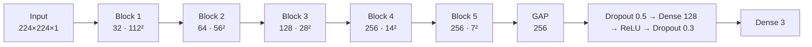

# Models

All models take a 224 × 224 MRI slice and output 3 logits (meningioma, glioma, pituitary).
They are built by `brain_tumor.models.factory.build_model(cfg)` from `params.yaml > models`.

## Model A — Custom CNN (from scratch)

### Architecture

Each block = **(Conv 3×3 → BatchNorm → ReLU) × 2 → MaxPool 2×2**.

| Stage | Output | Parameters |
|---|---|---|
| Input | 224 × 224 × 1 | 0 |
| Block 1 (32 filters) | 112 × 112 × 32 | 9.6 k |
| Block 2 (64) | 56 × 56 × 64 | 55.6 k |
| Block 3 (128) | 28 × 28 × 128 | 221.7 k |
| Block 4 (256) | 14 × 14 × 256 | 885.8 k |
| Block 5 (256) | 7 × 7 × 256 | 1.18 M |
| Global average pooling | 256 | 0 |
| Dropout → Dense 128 → ReLU → Dropout | 128 | 32.9 k |
| Dense 3 | 3 | 387 |
| **Total** | 10 conv layers, 1 hidden dense layer | **2,386,595** |

(Convolutions have no bias when followed by BatchNorm, which already has one.)

### Design choices

| Choice | Reason |
|---|---|
| 3×3 kernels, two per block | Two stacked 3×3 see a 5×5 area with fewer weights and one more non-linearity |
| Filters doubled when resolution halves | Trades spatial detail for richer features, balanced cost per layer |
| 5 blocks | Receptive field ≈ **156 px**, enough to cover a tumour and its surroundings. A 3-layer CNN only reaches ~22 px and underfits |
| BatchNorm | Faster, more stable training; allows lr = 1e-3 |
| Global average pooling | 33 k parameters into the classifier instead of 1.6 M with Flatten → less overfitting |
| One hidden dense layer | Features are learnt by the convolutions; more dense layers mostly add overfitting |
| Dropout only in the classifier | Regularises where the parameters are dense |
| He (Kaiming) initialisation | Standard for ReLU networks |
| Non in-place ReLU | Lets Grad-CAM hook the last activation |

### Configurable variants (ablations)

Everything is set in `params.yaml > models.custom_cnn`, so ablations are one override away:

| Variant | Override |
|---|---|
| Lighter CNN (4 blocks, 1 conv/block) | `models.custom_cnn.filters=[32,64,128,256] models.custom_cnn.convs_per_block=1` |
| No BatchNorm | `models.custom_cnn.batch_norm=false` |
| Flatten instead of GAP | `models.custom_cnn.global_pool=flatten` |
| No dropout | `models.custom_cnn.dropout_before_dense=0 models.custom_cnn.dropout_after_dense=0` |
| No augmentation | `train.augment=false` |

## Models B/C — Pretrained backbones (transfer learning)

| Model | Parameters (3-class head) | Grad-CAM layer |
|---|---|---|
| ResNet-18 | 11.18 M | `layer4[-1]` |
| ResNet-50 | 23.51 M | `layer4[-1]` |
| EfficientNet-B0 | 4.01 M | `features[-1]` |
| DenseNet-121 | 6.96 M | `features.denseblock4` |

### Recipe (identical for every backbone)

| Step | Setting |
|---|---|
| Input | grey channel repeated ×3, ImageNet mean/std normalisation, 224 × 224 |
| Head | original classifier replaced by Dropout(0.4) → Linear(3) |
| Stage 1 — head only | backbone frozen (BatchNorm statistics kept fixed), `freeze_epochs` = 3, lr 1e-3 |
| Stage 2 — fine-tuning | everything unfrozen, **discriminative learning rates**: early layers 1e-5, late layers 1e-4, head 1e-3 |
| Optimiser / schedule | AdamW (weight decay 1e-4), 1-epoch warm-up + cosine decay per stage |
| Loss | weighted cross-entropy, label smoothing 0.1 |
| Selection | best validation macro-F1, early stopping (patience 5) |
| Evaluation | test-time augmentation (horizontal flip), Grad-CAM |

**Why two stages?** A randomly initialised head sends large, noisy gradients into the
pretrained weights. Training it first protects the backbone.

**Why discriminative learning rates?** Early layers detect generic edges and textures that
transfer well, so they should move least; late layers are task-specific.

**Parameter groups** used for discriminative rates:

| Backbone | early | late | head |
|---|---|---|---|
| ResNet | conv1, bn1, layer1, layer2 | layer3, layer4 | fc |
| EfficientNet | features[0:4] | features[4:] | classifier |
| DenseNet | conv0 … transition2 | denseblock3 … norm5 | classifier |

A unit test checks that every parameter belongs to exactly one group.

### Why not VGG16?

About 138 M parameters for no accuracy gain on 2 k training images: slow on Colab and
prone to overfitting. ResNet/EfficientNet/DenseNet give a better accuracy-to-cost ratio.

## Adding a model

1. Write a builder returning an `nn.Module` with 3 outputs.
2. Register it in `models/factory.py` (and parameter groups + Grad-CAM layer if pretrained).
3. Add it to the parametrised tests in `tests/test_models.py`.
4. Document it here.
