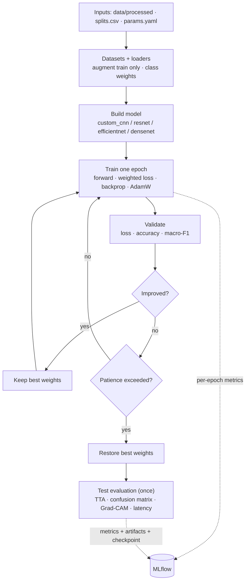

# Training

## Workflow



Entry point: `python -m brain_tumor.train [overrides] [--run-name] [--register] [--promote]`.

## Step by step

| Step | What happens | Why |
|---|---|---|
| 1. Inputs | `dvc pull` gives the exact data version; the run is fully defined by data + code commit + params | Reproducibility |
| 2. Loaders | arrays preloaded in RAM; train set shuffled and augmented; val/test untouched; class weights from the training set | Fight overfitting and class imbalance |
| 3. Model | built from `params.yaml`; parameter count logged | Fair, configurable comparison |
| 4. Train epoch | AMP on GPU, weighted cross-entropy with label smoothing, AdamW | Speed, imbalance, calibration |
| 5. Validate | loss, accuracy, macro-F1 logged to MLflow at every epoch | Live curves; macro-F1 weighs the small meningioma class equally |
| 6. Select / stop | best weights by validation macro-F1; early stopping on patience | Keep the best model, save GPU time |
| 7. Test | evaluated **once** with the best weights; TTA, confusion matrix, per-class metrics, Grad-CAM, latency, size | Honest final numbers |

## Outputs of a run

Local folder `models/<model>/<run-name>-<timestamp>/` and MLflow artifacts:

| File | Content |
|---|---|
| `best.pt` | weights + model name + config + preprocessing parameters |
| `training_curves.png` | loss, accuracy and validation macro-F1 per epoch |
| `confusion_matrix.png` | test confusion matrix (counts and row percentages) |
| `classification_report.txt` | per-class precision / recall / F1 |
| `test_predictions.csv` | per-image prediction and probabilities |
| `gradcam.png` | heatmaps on correct and wrong predictions, tumour contour in green |
| `test_metrics.json`, `summary.json`, `history.json` | all numbers |

MLflow metrics: per-epoch `train_loss`, `train_accuracy`, `val_loss`, `val_accuracy`,
`val_macro_f1`, `lr`; final `best_val_macro_f1`, `test_accuracy`, `test_macro_f1`,
`test_recall_<class>`, `test_inference_ms_per_image`, `test_n_parameters`, `train_minutes`.

Tags: `git.commit`, `git.branch`, `git.dirty`, `data.processed_md5`, `data.splits_md5`,
`model`, `split_column`, `device`.

## Metrics

| Metric | Why it is reported |
|---|---|
| Macro-F1 | **Selection metric.** Average of per-class F1, so meningioma (23 % of images) counts as much as glioma (47 %) |
| Accuracy | Intuitive, but dominated by the majority class |
| Per-class recall | Shows which tumour type is missed (meningioma is usually the hardest) |
| Confusion matrix | Which classes are confused with which |
| Parameters, size, ms/image | Cost side of the comparison |

Always compare against the majority-class baseline (`make baseline`): ~0.45 accuracy and
~0.21 macro-F1 on a typical patient-level test set.

## Hyperparameter optimisation (Optuna)

```bash
python -m brain_tumor.tune train.model=custom_cnn tune.n_trials=20
python -m brain_tumor.train train.model=custom_cnn --best-params configs/best_params/custom_cnn.yaml
```

| Element | Setting |
|---|---|
| Objective | best **validation** macro-F1 (the test set is never used) |
| Sampler | TPE, seeded |
| Pruner | Median pruner after `pruner_warmup_epochs` (3) |
| Trial length | `tune.epochs` (10) — same budget for every model |
| Storage | `optuna_<model>.db` (an interrupted study resumes) |
| Tracking | one parent MLflow run, one nested run per trial |
| Output | `configs/best_params/<model>.yaml`, `reports/tuning/<model>/` (trials, history, importance) |

Search spaces (`params.yaml > tune.search_space`):

| Custom CNN | Pretrained |
|---|---|
| lr 1e-4 → 3e-3 (log) | backbone lr 1e-5 → 5e-4 (log) |
| weight decay 1e-5 → 1e-2 (log) | weight decay 1e-5 → 1e-2 (log) |
| dropout 0.2 → 0.6 | dropout 0.2 → 0.6 |
| dense units 64 / 128 / 256 | freeze epochs 0 / 2 / 4 |
| base filters 16 / 32, blocks 4 / 5 | |

Fairness rules: give every compared model the **same number of trials**, keep the number of
trials moderate (the validation set has only ~35 patients), and confirm the final
configuration with patient-level cross-validation if time allows.

## Reproducibility

- Seeds fixed for Python, NumPy, PyTorch and DataLoader workers (`utils.set_seed`).
- All settings in `params.yaml`; command-line overrides are logged with the run.
- Data version from `dvc.lock`, code version from Git, both logged as tags.
- cuDNN autotuning is on by default for speed; for bit-exact repeats call
  `set_seed(seed, deterministic=True)`.

## Practical tips

- **Sanity check first:** a quick run with `train.epochs=1 train.max_batches=2` must finish
  without error before launching long runs.
- **Colab memory:** lower `train.batch_size` if CUDA runs out of memory; AMP is on by default.
- **Timing:** each epoch's duration is in the logs; `train_minutes` is logged to MLflow for the cost comparison.
